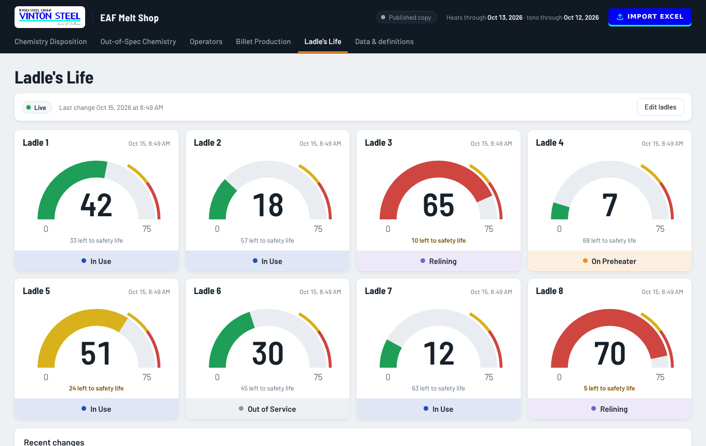
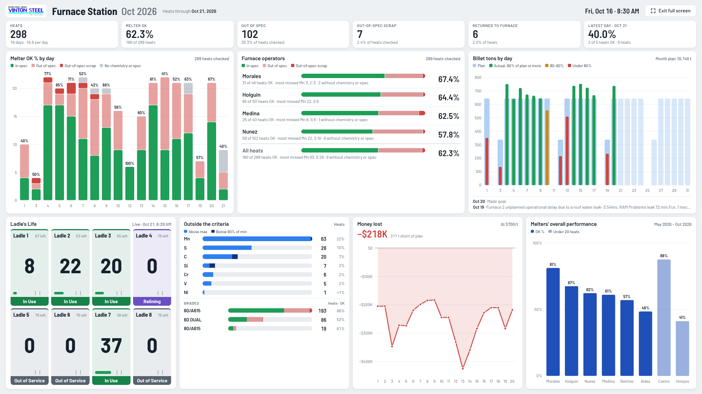
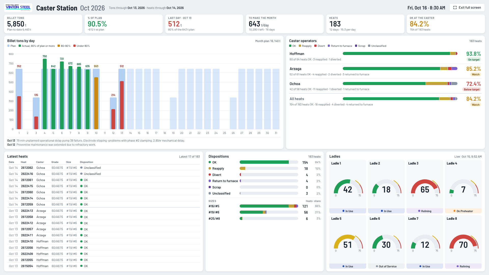

# EAF Melt Shop KPIs

Chemistry dispositions, out-of-spec results, operator spec performance and billet production for the Vinton Steel EAF Melt Shop, built from the monthly Excel reports.

## Pages

| Page | What it answers |
| --- | --- |
| **Chemistry Disposition** | How many heats were OK, reapplied, diverted, returned to the furnace or scrapped, by crew. |
| **Out-of-Spec Chemistry** | Which elements missed spec, on which heats, and whether they ran above the maximum or below the minimum. |
| **Operators** | Each melter's OK % under the furnace melter criteria. Each station's operators are judged on their own work: furnace operators by the chemistry at the furnace, caster operators by OK out of OK + reapplied at the caster (diverts, returns to the furnace, scrap and holds are left out). Also how each pairing performed, and each heat's path from furnace to caster (for example, in spec at the furnace but returned to the furnace at the caster). |
| **Billet Production** | Daily billet tons against plan, the variance to plan and the estimated production loss. |
| **Ladle's Life** | The lining life of the 8 ladles against their safety life, and each ladle's status: In Use (green), On Preheater (orange), Relining (purple) or Out of Service (gray). Anyone holding an edit key updates the numbers and statuses right on the page, and every change is logged. |
| **Furnace Station** | A one-screen view for the TV at the furnace: heats, melter OK %, out of spec and out-of-spec scrap, melter OK % by day, the furnace operators, billet tons by day, money lost against plan, a Ladle's Life preview, the elements and grades outside the criteria, and each melter's overall performance across all months. |
| **Caster Station** | A one-screen view for the TV at the caster: billet tons against plan, the tons a day still needed to make the month, the last day, OK at the caster, billet tons by day with the latest shift comments, money lost against plan as a running total, the caster operators, a Ladle's Life preview, the dispositions and sizes cast, and caster performance by day. |
| **Data & definitions** | Which Excel file each month came from, the days it covers, and how every number is worked out. |

Each page has a month picker and its own filters (crew, grade, disposition, spec source), and the detail tables can be searched and sorted.

| Out-of-Spec Chemistry | Operators |
| --- | --- |
|  |  |
| **Billet Production** | **Import Excel** |
|  |  |

**Ladle's Life**

**Operators page:** each station's operators, and each heat from furnace to caster

**Furnace Station**

**Caster Station**

## Station TVs

1. On the computer connected to the TV, open **Furnace Station**, **Caster Station** or **Ladle's Life**.
2. Click **Full screen**. The page fills the screen and sizes itself to it, so everything fits with no scrolling on any TV, from 720p to 4K.
3. To leave, press **Esc** or move the mouse and click **Exit full screen**.

While it is full screen, the page keeps the screen from going to sleep where the browser allows it, and hides the mouse pointer after a few seconds. It checks for newly published data every 10 minutes and updates itself without leaving full screen.

For a TV computer that opens the browser on its own, use these links. They open the station already filling the window; start the browser in full-screen or kiosk mode:

- Furnace: `https://shhimena.github.io/eaf-melt-shop/#furnace-station/tv`
- Caster: `https://shhimena.github.io/eaf-melt-shop/#caster-station/tv`
- Ladle's Life: `https://shhimena.github.io/eaf-melt-shop/#ladles/tv` (the 8 ladles fill the screen, with a count of each status; it picks up ladle changes every minute)

## Adding a new month

1. Open the [dashboard](https://shhimena.github.io/eaf-melt-shop/) and click **Import Excel** in the top right. Importing needs the editing password (the same one as for the ladles): the first time on a computer, type it and your name and click **Unlock importing**. The computer remembers it until **Lock importing** is clicked.
2. Pick the month's workbooks, or drag the whole Vinton KPIs folder onto the page:
   - `Melt Shop Chemistry Results Report <Month> <Year>.xlsx`
   - `VT_STEEL_Production and Shipments_Template <Month> <Year>.xlsx`
3. Check the summary. It lists each file with the month and days it covers. Files that aren't one of these reports, or can't be read, are listed and skipped.
4. The new month shows up on every page right away. It is kept **only in your browser** until you click **Remove import**.

The files are read on your own computer. Nothing is shared until you publish it.

### Publishing it for everyone

Click **Publish for everyone** in the yellow bar. The site updates for everyone within a few minutes.

**Download updated site** saves a copy of the whole site with the new month built in, for sending to the site owner instead.

## Editing the ladles

Anyone can view **Ladle's Life**. Each ladle shows its life, its status and its refractory brand. To change a ladle, click **Edit ladles**, type the editing password and your name, and click **Unlock**. The page remembers it on that computer until **Lock this computer** is clicked. The same unlock also opens importing. Each card has the life, the status and a **Refractory brand** box (it suggests brands already used). Each save updates `ladles.json` in this repository, adds the change to the log, and shows for everyone within a minute or two.

### Setting up editing (site owner)

1. On GitHub, open **Settings → Developer settings → Personal access tokens → Fine-grained tokens** and click **Generate new token**.
2. Name it (for example *Ladle editor*) and pick an expiration date.
3. Under **Repository access**, choose **Only select repositories** and pick **eaf-melt-shop**.
4. Under **Permissions → Repository permissions**, set **Contents** to **Read and write**. Leave everything else as it is.
5. Click **Generate token** and copy it (it starts with `github_pat_`).
6. On the dashboard, open **Ladle's Life**, click **Edit ladles**, paste the key and your name, and click **Unlock**.
7. In **Editing password**, type a password of at least 12 characters twice and click **Save password**. A few words with spaces work well.
8. Give that password to the people who update the ladles or import the monthly reports. They never need the GitHub key.

The password unlocks the GitHub key, and the key can change files in this repository, so share the password only with people who should edit the ladles and import reports. Only the locked form of the key is saved in `ladles.json`. To change the password, unlock editing and save a new one. To take access away from everyone, delete the token on GitHub. When it expires, make a new one and repeat steps 6 and 7.

## How the numbers are worked out

- **One sheet per day.** Each daily sheet in the chemistry workbook (named `MM.DD.YY`) is one production day. The `SPEC.` row on a sheet sets the grade, product and limits for the heats below it.
- **Operators.** The MELTER line reads `Furnace / Caster`. The first name is the furnace operator (also used as the crew), and the second is the caster operator. A ditto mark (`"`) repeats the name above, and spelling variants are merged (for example Nuñez and Nunes become Nunez).
- **Dispositions.** Each heat is grouped as OK, Reapply, Divert, Return to furnace (RTF), Scrap or Hold. Hold is a heat with no disposition yet, or one whose disposition is none of the others (such as QC Hold).
- **Duplicate heats.** A heat listed twice is counted once. The row with a disposition wins, then the latest date.
- **Where the numbers come from.** Every heat, reading, disposition and ton comes from the two monthly Excel reports. The only things not in the Excel are the melter criteria (from the printed *Instructions for chemistry disposition* and *Vinton Grades Spec criteria*) and the billet price you pick for the estimated production loss.
- **Spec toggle.** *Melter criteria* (the Operators page default) applies the furnace melter rules below. *Daily sheet* checks each heat against its own sheet's `SPEC.` row. CE is not checked, since there is no CE spec.
- **Readings toggle.** *Exact* compares the lab reading as reported. *Rounded to spec* first rounds it to the spec's decimal places (ASTM E29 style).
- **Melter criteria.** From the *Instructions for chemistry disposition*, using the SPEC rows of the *Vinton Grades Spec criteria* sheet for 40/A615 and 60/A615 (#4 to #11). Grades and sizes not on that sheet, such as 60(A706/A615) DUAL and 80/A615, use the `SPEC.` row on their daily sheet. The Data & definitions page lists every range.
  - **C, Mn, Si, V** must be inside the OK range: 90% of the low spec up to the max spec. Outside it is *out of spec*.
  - **P, S** over the max are *out of spec*.
  - **Ni, Mo, Cu** over the max are *out-of-spec scrap*.
  - **Cr** under 90% of the low spec is *out of spec*; over the max is *out-of-spec scrap*.
  - **Melter OK %** is the share of a melter's heats with nothing outside these limits. It is shown without a target: the 90% target in the instructions applies to the FL1 sample, which the monthly reports don't include yet.
  - The instructions call for the FL1 sample. The monthly report only carries the final chemistry (the average of the final samples), so the rules are applied to that.
- **Furnace to caster.** *At the furnace* is the heat's chemistry result: in spec, out of spec, out-of-spec scrap, no spec to check against, or no chemistry entered. *At the caster* is its disposition category. **In spec, not OK at caster** counts heats with in-spec chemistry that were still reapplied, diverted, returned to the furnace or scrapped.
- **Station pages.** The Furnace Station always uses the melter criteria with exact readings. *Latest heats* lists the newest heats first and shows as many as fit. *To make the month* is the month's planned tons still left, spread over the planned days that remain after the last day with actual tons.
- **Ladle's Life.** Each gauge runs from 0 to the safety life (75). It is green below 50, yellow from 50 and red from 60; editors can change those limits on the page. The ladles live in `ladles.json` in this repository, and each save on the page is a commit to that file. This site is the only place ladles are kept; on the Claude link, the Ladle's Life tab opens this site.
- **Targets.** For the caster, billet and disposition rates, 90% and up is on target, 80–90% is flagged to watch, and anything lower is below target. Melter OK % has no target (see above).
- **Billet.** Planned and actual tons come from the *EAF Daily Objective* sheet. Estimated production loss is the tons short of plan times the billet price per ton you pick (the price is not in the Excel).

The **Data & definitions** page lists every month that is included and flags months with missing or partial reports.

## What's in this repository

| Path | What it is |
| --- | --- |
| `index.html` | The whole dashboard in one file: the page, the charts, the Excel reader and the data. GitHub Pages serves it at the link above. A downloaded copy also opens by double-clicking it (the charts need an internet connection). |
| `docs/` | The Vinton Steel logo and the screenshots in this guide. |
| `ladles.json` | The current ladle life and status, the gauge limits, and the change log. The Ladle's Life page reads and saves it. |
| `.nojekyll` | Tells GitHub Pages to serve the files as they are. |

## Built with

- [D3.js](https://d3js.org/) for the charts
- [SheetJS](https://sheetjs.com/) for reading the Excel workbooks in the browser
- [Barlow](https://fonts.google.com/specimen/Barlow) typeface

## Access

This repository and the dashboard are public, so anyone with the link can see the data.

---

Data: Vinton Steel monthly Melt Shop Chemistry Results and VT_STEEL Production and Shipments reports. Maintained by [@shhimena](https://github.com/shhimena).
