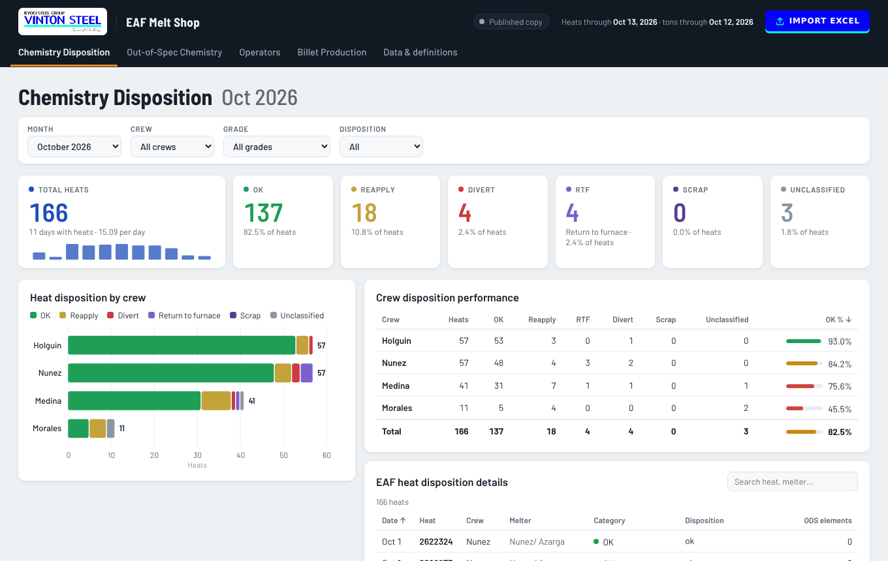
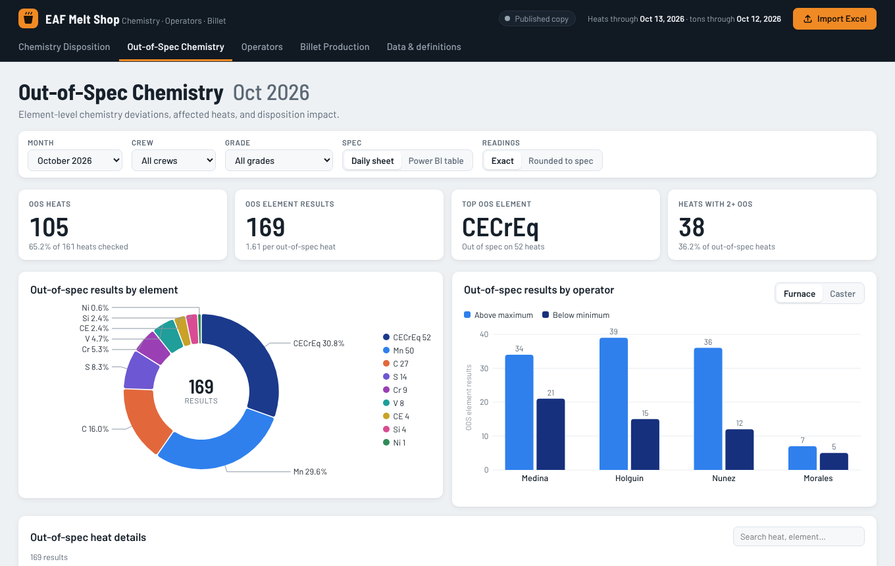
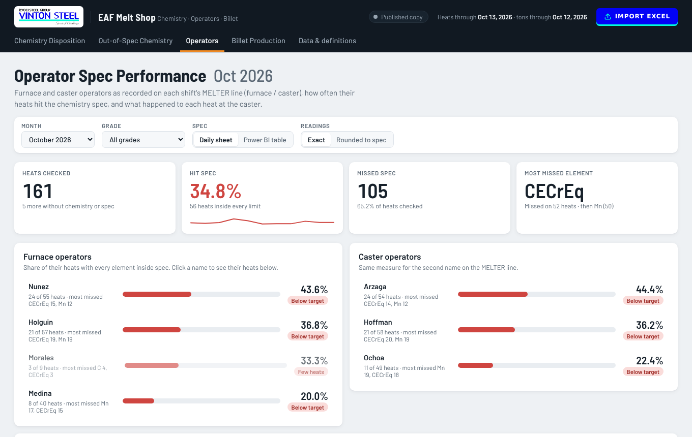
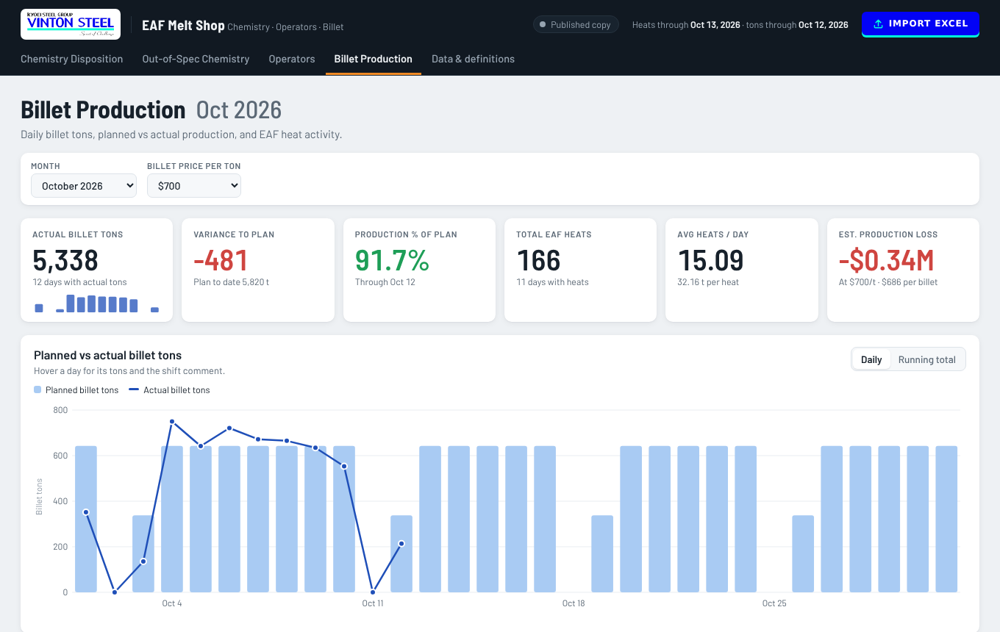
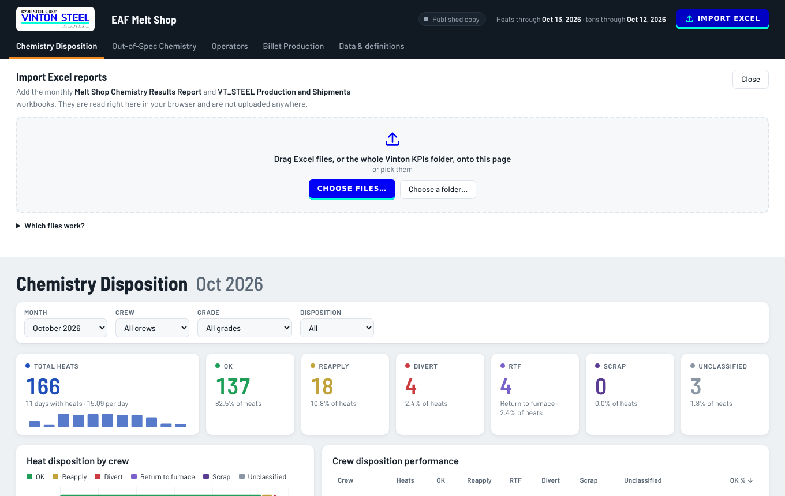
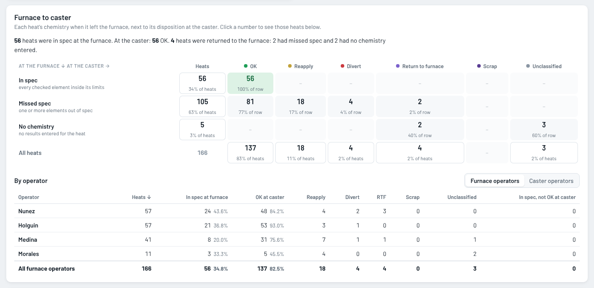

# EAF Melt Shop KPIs

Chemistry dispositions, out-of-spec results, operator spec performance and billet production for the Vinton Steel EAF Melt Shop, built from the monthly Excel reports.

## Pages

| Page | What it answers |
| --- | --- |
| **Chemistry Disposition** | How many heats were OK, reapplied, diverted, returned to the furnace or scrapped, by crew. |
| **Out-of-Spec Chemistry** | Which elements missed spec, on which heats, and whether they ran above the maximum or below the minimum. |
| **Operators** | How often each furnace operator's and caster operator's heats landed inside every spec limit, how each pairing performed, and each heat's path from furnace to caster (for example, in spec at the furnace but returned to the furnace at the caster). |
| **Billet Production** | Daily billet tons against plan, the variance to plan and the estimated production loss. |
| **Data & definitions** | Which Excel file each month came from, the days it covers, and how every number is worked out. |

Each page has a month picker and its own filters (crew, grade, disposition, spec source), and the detail tables can be searched and sorted.

| Out-of-Spec Chemistry | Operators |
| --- | --- |
|  |  |
| **Billet Production** | **Import Excel** |
|  |  |

**Furnace to caster** (Operators page)

## Adding a new month

1. Open the [dashboard](https://shhimena.github.io/eaf-melt-shop/) and click **Import Excel** in the top right.
2. Pick the month's workbooks, or drag the whole Vinton KPIs folder onto the page:
   - `Melt Shop Chemistry Results Report <Month> <Year>.xlsx`
   - `VT_STEEL_Production and Shipments_Template <Month> <Year>.xlsx`
3. Check the summary. It lists each file with the month and days it covers. Files that aren't one of these reports, or can't be read, are listed and skipped.
4. The new month shows up on every page right away. It is kept **only in your browser** until you click **Remove import**.

The files are read on your own computer and never uploaded anywhere.

### Publishing it for everyone

1. Click **Download updated site**. You get a file named `EAF-Melt-Shop-KPIs-<date>.html`.
2. Rename it to `index.html`.
3. In this repository, click **Add file → Upload files**, drop in `index.html` and click **Commit changes**.

The dashboard link shows the new data within a minute or two.

## How the numbers are worked out

- **One sheet per day.** Each daily sheet in the chemistry workbook (named `MM.DD.YY`) is one production day. The `SPEC.` row on a sheet sets the grade, product and limits for the heats below it.
- **Operators.** The MELTER line reads `Furnace / Caster`. The first name is the furnace operator (also used as the crew), and the second is the caster operator. A ditto mark (`"`) repeats the name above, and spelling variants are merged (for example Nuñez and Nunes become Nunez).
- **Dispositions.** Each heat is grouped as OK, Reapply, Divert, Return to furnace (RTF), Scrap or Unclassified.
- **Duplicate heats.** A heat listed twice is counted once. The row with a disposition wins, then the latest date.
- **Spec toggle.** *Daily sheet* checks each heat against its own sheet's `SPEC.` row. *Power BI table* uses the fixed Grade 60 / A615 limits from the original Power BI report and matches its numbers.
- **Readings toggle.** *Exact* compares the lab reading as reported. *Rounded to spec* first rounds it to the spec's decimal places (ASTM E29 style).
- **Furnace to caster.** *At the furnace* is the heat's chemistry result: in spec, missed spec, no spec to check against, or no chemistry entered. *At the caster* is its disposition category. **In spec, not OK at caster** counts heats with in-spec chemistry that were still reapplied, diverted, returned to the furnace or scrapped.
- **Targets.** Rates of 90% and up are on target, 80–90% are flagged to watch, and anything lower is below target.
- **Billet.** Planned and actual tons come from the *EAF Daily Objective* sheet. Estimated production loss is the tons short of plan times the billet price you pick.

The **Data & definitions** page lists every month that is included and flags months with missing or partial reports.

## What's in this repository

| Path | What it is |
| --- | --- |
| `index.html` | The whole dashboard in one file: the page, the charts, the Excel reader and the data. GitHub Pages serves it at the link above. A downloaded copy also opens by double-clicking it (the charts need an internet connection). |
| `docs/` | The Vinton Steel logo and the screenshots in this guide. |
| `.nojekyll` | Tells GitHub Pages to serve the files as they are. |

## Built with

- [D3.js](https://d3js.org/) for the charts
- [SheetJS](https://sheetjs.com/) for reading the Excel workbooks in the browser
- [Barlow](https://fonts.google.com/specimen/Barlow) typeface

## Access

This repository and the dashboard are public, so anyone with the link can see the data.

---

Data: Vinton Steel monthly Melt Shop Chemistry Results and VT_STEEL Production and Shipments reports. Maintained by [@shhimena](https://github.com/shhimena).
